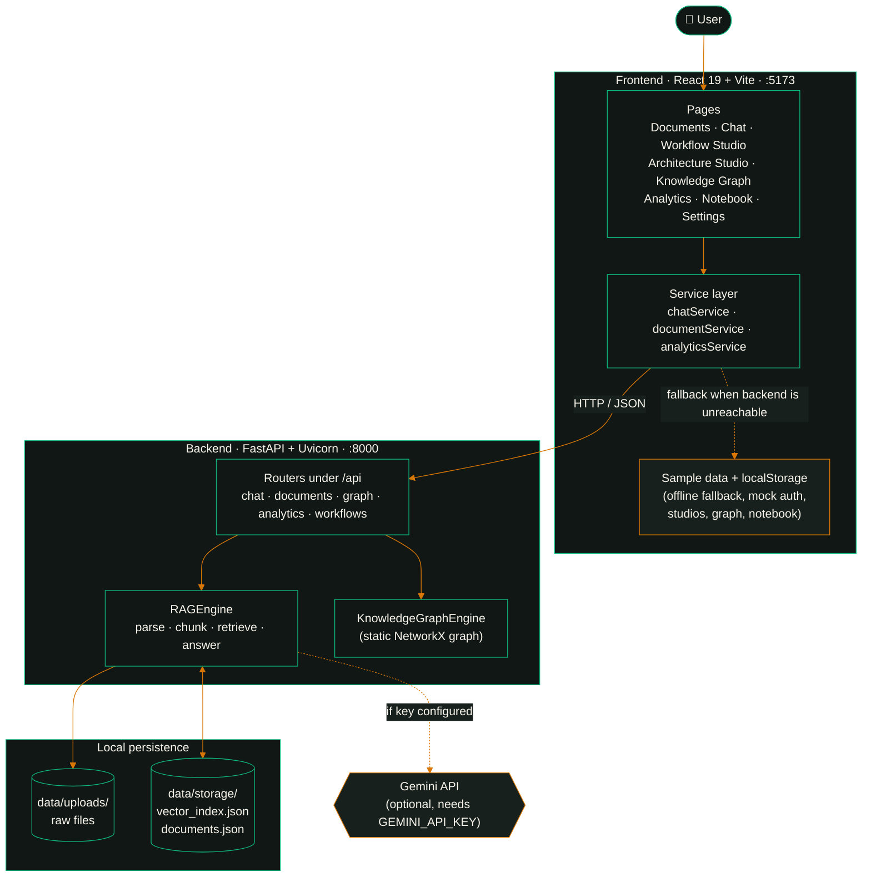
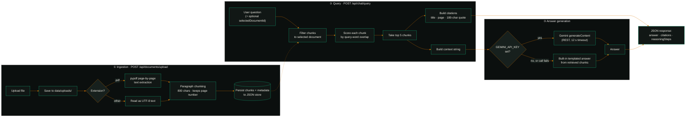
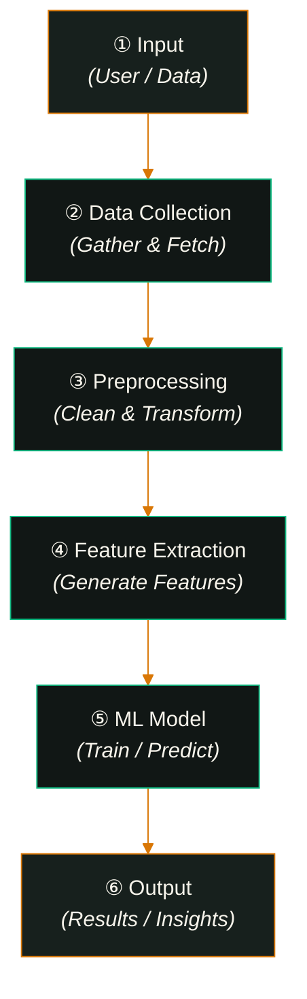
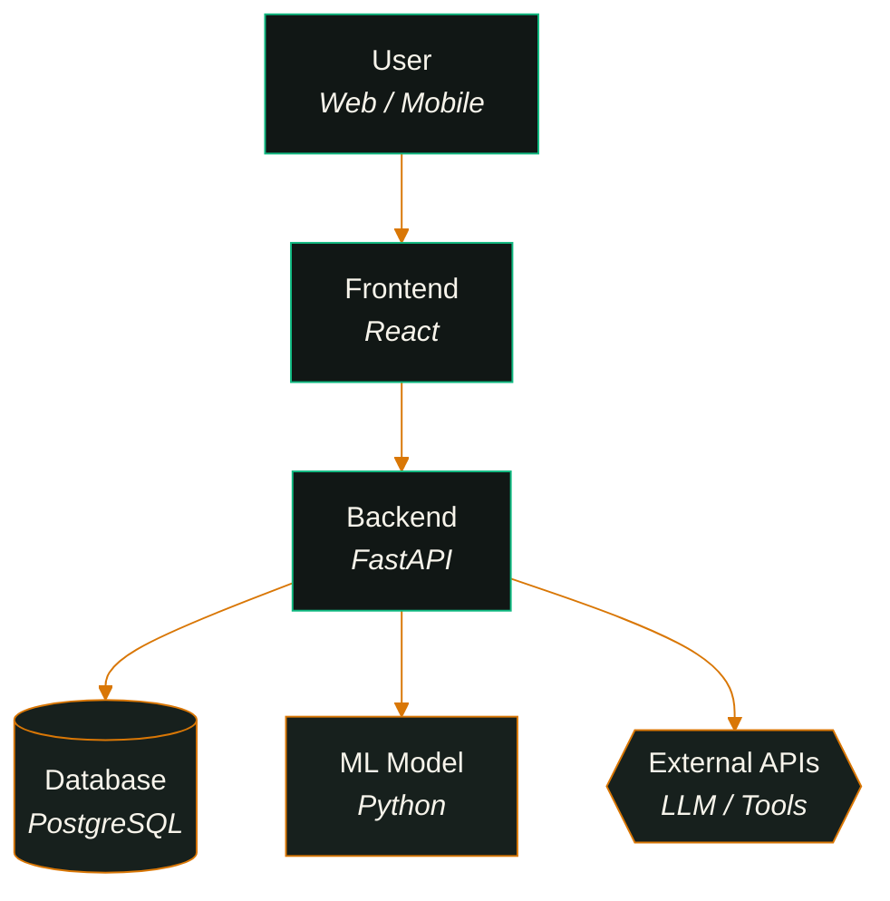

<div align="center">

<br/>

# COGNIVIS

### Multimodal Document Intelligence & Visual Reasoning Platform

*From documents to deeper understanding. Upload. Ask. Visualize. Build.*

<br/>


<br/>

[Overview](#-overview) · [Features](#-features) · [Architecture](#-system-architecture) · [Screenshots](#-screenshots) · [Setup](#-installation-on-windows) · [API](#-backend-api-endpoints) · [Roadmap](#-known-limitations--roadmap)

</div>

---

> **A note on honesty.** Cognivis is an active prototype. This README separates what is **implemented and verified in the code** from what is **simulated with sample data** and what is **planned**. Status legend used throughout:
>
> | Badge | Meaning |
> |:--:|---|
> | ✅ | Implemented and wired end-to-end in the repository |
> | 🧪 | UI implemented, but driven by sample / mock data |
> | 🗺️ | Planned, not implemented |

---

## ✦ Overview

Cognivis is a document-intelligence workspace. You upload documents, ask questions about them, and receive answers that carry **source citations** (document title, page, and a quoted passage). Around that core, the app provides visual surfaces for exploring knowledge: a Workflow Studio, an Architecture Studio, a Knowledge Graph, an Analytics dashboard, and a Notebook.

The project pairs a **React + TypeScript** single-page frontend with a **FastAPI** backend that handles document ingestion, chunking, retrieval and (optionally) answer generation through the Gemini API.

### The problem

Knowledge workers, students and engineers routinely work with long PDFs, specifications and reports. Three problems recur:

1. **Finding answers is slow.** Keyword search across many documents returns pages, not answers.
2. **Generated answers are hard to trust.** A fluent answer with no pointer back to the source cannot be verified.
3. **Structure stays buried in prose.** Processes and system designs described in text are hard to see as pipelines or architectures.

Cognivis targets all three: retrieve from your own documents, show the evidence behind each answer, and present structure visually.

---

## ✦ Features

### Implemented and wired to the backend ✅

| Capability | Details |
|---|---|
| **Document upload & ingestion** | Files are uploaded to the FastAPI backend, saved to `backend/data/uploads/`, chunked, and indexed into a local JSON store. |
| **PDF text extraction** | PDFs are parsed page by page with `pypdf`, so chunks keep their page number. |
| **Paragraph-based chunking** | Chunk size 800 characters (`CHUNK_SIZE`); retrieval returns up to 5 chunks (`TOP_K_RETRIEVAL`). |
| **Document-scoped Q&A** | Chat can be restricted to a single selected document via `selectedDocumentId`. |
| **Citations** | Each response returns citations with document title, page number and a quoted snippet. |
| **Reasoning steps** | Responses include a three-step reasoning trace (intent, retrieval, synthesis). |
| **Optional Gemini generation** | If `GEMINI_API_KEY` is set, retrieved context is sent to the Gemini REST API to generate the answer. |
| **Document deletion** | Removes a document and its chunks from the index. |
| **Health endpoint** | Reports whether a Gemini key is configured, plus document and chunk counts. |
| **Graceful offline mode** | If the backend is unreachable, the frontend falls back to local sample data instead of failing. |

### UI implemented with sample data 🧪

| Screen | Route | Current behavior |
|---|---|---|
| **Workflow Studio** | `/workflows` | Interactive React Flow canvas with a 6-node sample pipeline, add-node modal, and JSON export. Nodes come from `src/data/mockWorkflow.ts`; they are **not** generated from your documents. |
| **Architecture Studio** | `/architecture` | React Flow canvas with a 6-component sample system and JSON export. Data comes from `src/data/mockArchitecture.ts`; **not** generated from documents. |
| **Knowledge Graph** | `/knowledge-graph` | Category filtering, search and node details over `src/data/mockKnowledgeGraph.ts`. The frontend does not call the backend graph endpoint. |
| **Analytics** | `/analytics` | Charts built with Recharts. The summary endpoint exists, but most of its figures are hardcoded placeholders (see limitations). |
| **Notebook** | `/notebook` | Notes CRUD over in-memory sample data (`notebookService.ts`). |
| **Authentication** | `/signin`, `/signup` | Mock, client-side sessions persisted in `localStorage`. There is no real backend auth. |
| **Command palette, notifications, settings, toasts** | n/a | Frontend-only UI components. |

### Planned 🗺️

See [Known Limitations & Roadmap](#-known-limitations--roadmap).

---

## ✦ Technology Stack

**Frontend** (from `package.json`)

| Area | Technology |
|---|---|
| Framework | React 19, TypeScript, Vite 8 |
| Routing | React Router 7 |
| Styling | Tailwind CSS 3.4, `clsx`, `tailwind-merge` |
| Visual canvases | `@xyflow/react` (React Flow) |
| Charts | Recharts |
| Motion & icons | Framer Motion, lucide-react |
| Linting | oxlint |

**Backend** (from `backend/requirements.txt`)

| Area | Technology |
|---|---|
| API framework | FastAPI, Uvicorn |
| Validation & settings | Pydantic v2, pydantic-settings, python-dotenv |
| Uploads | python-multipart |
| PDF parsing | pypdf |
| Graph data | NetworkX |
| LLM | Gemini API (called via REST; `google-generativeai` is also listed and initialized when a key is present) |

**Storage:** local JSON files in `backend/data/storage/` (no database).

---

## ✦ System Architecture

This diagram reflects what the code does today.



---

## ✦ RAG Workflow

The diagram below describes the **implemented** pipeline in `backend/core/rag_engine.py`.



> **Accuracy note.** Retrieval is currently **lexical word-overlap scoring**, not embedding-based search. The values `SIMILARITY_THRESHOLD` and the embedding model name exist in configuration, but no embedding or vector-similarity computation is performed in the current code.

---

## ✦ Workflow Studio

**Status: 🧪 UI implemented, sample data.** The canvas renders a six-stage pipeline from `src/data/mockWorkflow.ts`. Users can add nodes and export the workflow as JSON. Nodes are **not yet generated from uploaded documents.**



*Diagram shows the bundled sample workflow, which cites `Research_Paper.pdf` pages 2 to 5 in the UI.*

---

## ✦ Architecture Studio

**Status: 🧪 UI implemented, sample data.** The canvas renders a six-component system from `src/data/mockArchitecture.ts`, with layers (client, service, storage, AI, external) and a JSON export.



> ⚠️ This is the **sample system displayed in the studio**, not a description of Cognivis' own runtime. Cognivis itself does **not** currently use PostgreSQL; its backend persists to local JSON files (see the real architecture above). Edge directions follow the sample's layered layout.

---

## ✦ Screenshots

> **No screenshots are committed to the repository yet**, so none are displayed here. To populate this gallery, capture each screen and save it under `docs/screenshots/` using the filenames below, then uncomment the block.

| Screen | Route | Suggested file |
|---|---|---|
| Landing | `/landing` | `docs/screenshots/landing.png` |
| Home | `/home` | `docs/screenshots/home.png` |
| Documents | `/documents` | `docs/screenshots/documents.png` |
| Document Workspace | `/documents/:id` | `docs/screenshots/document-workspace.png` |
| Chat with citations | `/chat` | `docs/screenshots/chat.png` |
| Workflow Studio | `/workflows` | `docs/screenshots/workflow-studio.png` |
| Architecture Studio | `/architecture` | `docs/screenshots/architecture-studio.png` |
| Knowledge Graph | `/knowledge-graph` | `docs/screenshots/knowledge-graph.png` |
| Analytics | `/analytics` | `docs/screenshots/analytics.png` |
| Notebook | `/notebook` | `docs/screenshots/notebook.png` |

<!-- Uncomment after adding the screenshots:

<div align="center">

| | |
|:--:|:--:|
| <br/><sub><b>Landing</b></sub> | <br/><sub><b>Home</b></sub> |
| <br/><sub><b>Documents</b></sub> | <br/><sub><b>Chat with citations</b></sub> |
| <br/><sub><b>Workflow Studio</b></sub> | <br/><sub><b>Architecture Studio</b></sub> |
| <br/><sub><b>Knowledge Graph</b></sub> | <br/><sub><b>Analytics</b></sub> |

</div>

-->

---

## ✦ Project Structure

```text
Cognivis/
├── backend/
│   ├── core/
│   │   ├── rag_engine.py          # ingestion, chunking, retrieval, answer generation
│   │   └── graph_engine.py        # static NetworkX knowledge graph
│   ├── routers/
│   │   ├── chat.py                # /api/chat
│   │   ├── documents.py           # /api/documents
│   │   ├── graph.py               # /api/graph
│   │   ├── analytics.py           # /api/analytics
│   │   └── workflows.py           # /api/workflows
│   ├── data/
│   │   ├── uploads/               # uploaded files (includes a sample PDF)
│   │   └── storage/               # documents.json, vector_index.json
│   ├── config.py                  # settings and environment loading
│   ├── main.py                    # FastAPI app, CORS, router registration
│   ├── requirements.txt
│   └── .env.example
├── src/
│   ├── components/                # architecture, common, documents, layout, ui, workflow
│   ├── context/                   # AuthContext, WorkspaceContext
│   ├── data/                      # mock data for offline / sample mode
│   ├── hooks/                     # useChat, useDocuments, useWorkflow, ...
│   ├── layouts/                   # AppLayout
│   ├── lib/                       # utilities
│   ├── pages/                     # Analytics, ArchitectureStudio, Auth, Chat, DocumentWorkspace,
│   │                              # Documents, Home, KnowledgeGraph, Landing, NotFound,
│   │                              # Notebook, Settings, WorkflowStudio
│   ├── routes/                    # AppRoutes (protected routing)
│   ├── services/                  # API clients and local stores
│   ├── types/                     # TypeScript types
│   ├── App.tsx
│   └── main.tsx
├── public/                        # favicon, icons, images
├── dev.bat                        # starts backend + frontend on Windows
├── index.html
├── package.json
├── tailwind.config.js
├── vite.config.ts
└── tsconfig*.json
```

---

## ✦ Installation on Windows

### Prerequisites

- **Node.js**: a current LTS release (check the [Vite documentation](https://vite.dev/) for the minimum Node version required by Vite 8)
- **Python 3**: the repository was developed with Python 3.13 (based on committed bytecode); other 3.x versions are untested here
- **Git**
- *(Optional)* a **Gemini API key** for LLM-generated answers

### 1. Clone

```powershell
git clone https://github.com/Abdul-stack871/Cognivis.git
cd Cognivis
```

### 2. Backend setup

`dev.bat` expects a virtual environment named `.venv` in the **repository root**.

```powershell
python -m venv .venv
.venv\Scripts\activate
pip install -r backend\requirements.txt
copy backend\.env.example backend\.env
```

Then edit `backend\.env` and add your key (see [Environment Variables](#-environment-variables)). The key is optional; without it, the backend uses its built-in templated answers.

### 3. Frontend setup

```powershell
npm install
```

> If PowerShell blocks scripts with a `PSSecurityException`, use `npm.cmd` in place of `npm`, or run `Set-ExecutionPolicy -ExecutionPolicy RemoteSigned -Scope CurrentUser`.

### 4. Run

**Option A: one command** (starts the backend in a new window, then the frontend):

```powershell
.\dev.bat
```

**Option B: two terminals**

```powershell
# Terminal 1: backend (run from the repository root)
.venv\Scripts\python.exe -m uvicorn backend.main:app --host 127.0.0.1 --port 8000 --reload

# Terminal 2: frontend
npm.cmd run dev
```

| Service | URL |
|---|---|
| Frontend | http://localhost:5173 |
| Backend | http://localhost:8000 |
| Interactive API docs (Swagger) | http://localhost:8000/docs |

### 5. Sign in

The app opens on `/signin`. Authentication is a **client-side mock** (sessions live in `localStorage`); there is no real account backend.

### Other scripts

```powershell
npm run build     # type-check and production build
npm run lint      # oxlint
npm run preview   # preview the production build
```

---

## ✦ Environment Variables

Create `backend/.env` from `backend/.env.example`. **Never commit this file**; it is already listed in `.gitignore`.

| Variable | Required | Default | Purpose |
|---|:--:|---|---|
| `GEMINI_API_KEY` | Optional | empty | Enables live Gemini answer generation. If empty, answers are produced by the built-in fallback. |
| `OPENAI_API_KEY` | Optional | empty | Present in config and `.env.example`, but **not currently used** by any code path. |
| `DEFAULT_MODEL` | Optional | `gemini-2.0-flash` | Gemini model name used for generation. |
| `EMBEDDING_MODEL` | Optional | `models/text-embedding-004` | Present in config, but **not currently used**; no embeddings are computed. |

```dotenv
# backend/.env  (example, use your own values)
GEMINI_API_KEY=your_gemini_api_key_here
OPENAI_API_KEY=
DEFAULT_MODEL=gemini-2.0-flash
EMBEDDING_MODEL=models/text-embedding-004
```

Retrieval parameters (`CHUNK_SIZE=800`, `CHUNK_OVERLAP=150`, `TOP_K_RETRIEVAL=5`, `SIMILARITY_THRESHOLD=0.70`) are defined in `backend/config.py`. Of these, `CHUNK_OVERLAP` and `SIMILARITY_THRESHOLD` are not applied by the current chunking and retrieval code.

---

## ✦ Backend API Endpoints

All routes below were read directly from `backend/main.py` and `backend/routers/`. Base URL: `http://localhost:8000`.

| Method | Path | Description | Used by frontend |
|:--:|---|---|:--:|
| `GET` | `/` | Service status, name, version and docs path | n/a |
| `GET` | `/api/health` | Health check: `geminiConfigured`, `documentsCount`, `chunksCount` | no |
| `GET` | `/api/documents` | List indexed documents | ✅ |
| `POST` | `/api/documents/upload` | Upload a file (`multipart/form-data`, field `file`); parses, chunks and indexes it | ✅ |
| `DELETE` | `/api/documents/{document_id}` | Delete a document and its chunks (`404` if not found) | ✅ |
| `POST` | `/api/chat/query` | Body: `{ "content": string, "selectedDocumentId"?: string }`. Returns `answer`, `citations`, `reasoningSteps` (`400` on empty content) | ✅ |
| `GET` | `/api/chat/documents` | Returns the indexed documents list | no |
| `GET` | `/api/graph/data` | Static knowledge graph (nodes, edges, metrics) | no |
| `GET` | `/api/analytics/summary` | Summary metrics, knowledge growth, topic distribution | ✅ |
| `POST` | `/api/workflows/run` | Returns a **simulated** pipeline run result | no |

**Example: ask a question**

```bash
curl -X POST http://localhost:8000/api/chat/query \
  -H "Content-Type: application/json" \
  -d '{"content": "What is the primary objective?", "selectedDocumentId": null}'
```

> **Important behaviors**
> - `/api/analytics/summary` returns mostly **hardcoded** values (queries, latency, faithfulness, growth series, topic distribution). Only the active-document count and, in part, the last growth point reflect real index state.
> - `/api/workflows/run` does **not** execute anything. It returns a fixed, simulated stage list.
> - `/api/graph/data` returns a fixed graph defined in `graph_engine.py`.

---

## ✦ Known Limitations & Roadmap

### Known limitations (verified from the code)

- **Retrieval is lexical.** Chunks are ranked by query-word overlap. There are no embeddings, vector similarity, BM25 or rank fusion, even though some sample text and UI copy describe them.
- **Citation scores are not true similarity.** The returned `relevanceScore` is floored at 0.85 in code, so it is not a reliable relevance measure.
- **Non-PDF files are read as plain text.** DOCX, XLSX, and images are accepted by the upload dialog, but the backend does not parse them as structured formats, so DOCX, Excel and image content will not be extracted meaningfully. Only `.pdf` has a real parser.
- **Multimodal understanding is not implemented.** No OCR, image analysis, table extraction or figure understanding exists in the backend.
- **Fallback answers are canned.** Without a Gemini key (or if the call fails or times out), answers come from keyword-triggered templates, some of which describe the sample "Research Paper" content regardless of what you uploaded.
- **Seed data on first run.** If the index is empty, the backend seeds three sample documents and chunks. A sample PDF and index files are also committed under `backend/data/`.
- **Upload metadata is approximate.** `uploadedAt` is a fixed placeholder timestamp, and file size is reported in MB with a 0.1 MB floor.
- **Studios, Knowledge Graph and Notebook are not document-driven.** They render sample data; nothing is generated from uploaded documents, and the frontend does not call `/api/graph/data` or `/api/workflows/run`.
- **Analytics are largely placeholders** (see the API notes above).
- **Authentication is mocked** in the browser. There are no real accounts or server-side sessions.
- **Persistence is local JSON**, which is suitable for a prototype but not for concurrent or large-scale use.
- **CORS is open** (`allow_origins=["*"]`) and the frontend hardcodes `http://localhost:8000/api`. Tighten and externalize both before any deployment.
- **No automated tests** are present in the repository.
- **Repository hygiene.** Python `__pycache__` files are committed.

### Roadmap (planned, not implemented) 🗺️

- [ ] Real embedding-based retrieval, with a persistent vector store
- [ ] Hybrid (lexical plus dense) retrieval with rank fusion
- [ ] Proper parsers for DOCX, XLSX/CSV and images, including OCR
- [ ] Generate Workflow Studio pipelines from uploaded documents
- [ ] Generate Architecture Studio diagrams from uploaded documents
- [ ] Build the Knowledge Graph from document content and connect the UI to `/api/graph/data`
- [ ] Real analytics driven by recorded queries, latency and feedback
- [ ] Real authentication and per-user document storage
- [ ] Configurable API base URL and restricted CORS
- [ ] Automated tests and CI
- [ ] Deployment guide (containerization or hosting)

---

## ✦ Contributing

Contributions, issues and suggestions are welcome.

1. Fork the repository
2. Create a feature branch: `git checkout -b feature/your-feature`
3. Make your changes and verify with `npm run build` and `npm run lint`
4. Commit with a clear message: `git commit -m "Add your feature"`
5. Push the branch and open a Pull Request describing what changed and why

Please do not commit secrets such as `backend/.env` or API keys.

---

## ✦ License

No license file is currently included in this repository. Until the author adds one, all rights are reserved by default and the code is not licensed for reuse. If you intend to open-source Cognivis, add a `LICENSE` file and update this section.

---

<div align="center">

**Cognivis**  ·  *From documents to deeper understanding.*

Built by [Abdul](https://github.com/Abdul-stack871)

</div>